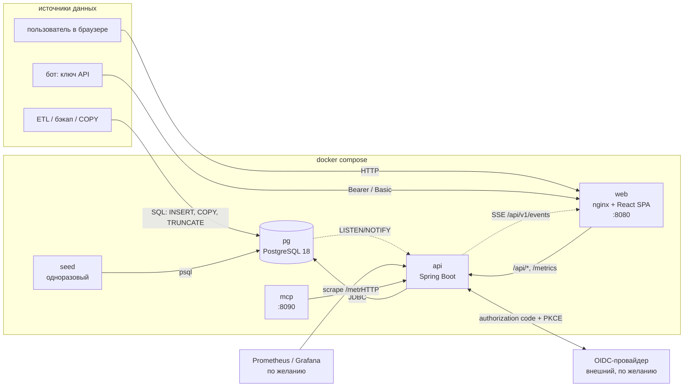

# Анализатор рисков оттока

Сервис ранжирует клиентов хостинг-провайдера по риску ухода, раскладывает оценку на понятные причины и считает, сколько выручки находится под угрозой. Панель для маркетолога, REST API для интеграций, метрики для мониторинга.

## Содержание

1. [Что это](#1-что-это)
2. [Быстрый запуск](#2-быстрый-запуск)
3. [Данные](#3-данные)
4. [Модель риска](#4-модель-риска)
5. [Архитектура](#5-архитектура)
6. [Как добавить признак](#6-как-добавить-признак)
7. [API](#7-api)
8. [Метрики](#8-метрики)
9. [Вход через SSO](#9-вход-через-sso)
10. [Интеграция для систем-источников](#10-интеграция-для-систем-источников)
11. [Разработка](#11-разработка)
12. [Переменные среды](#12-переменные-среды)

## 1. Что это

- **Кому.** Маркетологу и аналитику: нужен список клиентов, с которыми стоит поговорить сегодня, и понятная причина, почему именно с ними.
- **Почему.** Размеченной истории оттока в данных нет, поэтому обучать модель не на чем, а непрозрачная модель маркетологу не поможет. Используется аддитивная взвешенная модель: шесть признаков от 0 до 1, у каждого вес. Оценка риска (risk-score, 0..100) раскладывается на вклады признаков, а веса и пороги меняются в панели без перезапуска.
- **Сколько.** Для каждого клиента считаются ожидаемые потери за 30 дней: выручка действующих услуг, не обеспеченная деньгами на балансе, умноженная на оценку склонности к уходу (`risk-score / 100`). Это эвристическая денежная оценка, а не откалиброванная вероятность. Деньги везде в евро, в API и в базе хранятся в евроцентах.

В панели: обзор (показатели, распределение по уровням, график непродлений), рейтинг клиентов с фильтрами и выгрузкой в CSV, карточка клиента (причины, услуги, история оценок, деньги), настройка модели, загрузка данных, управление ключами ботов и пользователями.

## 2. Быстрый запуск

Нужны Docker с Compose v2 и make.

```bash
cp .env.example .env
make up
```

`make up` равносильно:

```bash
docker compose -f ops/compose/compose.yml --env-file .env up -d --build --wait pg api web mcp
docker compose -f ops/compose/compose.yml --env-file .env run --rm seed
```

Первая сборка образов занимает несколько минут (Gradle и npm скачивают зависимости).

Панель: **http://localhost:8080** (порт задаёт `WEB_PORT` в `.env`).

| Роль | Логин | Пароль |
|---|---|---|
| администратор | `admin` | `admin12345` |
| аналитик | `analyst` | `analyst12345` |

Пароли берутся из `.env` (`AUTH_BOOTSTRAP_ADMIN_PASSWORD`, `AUTH_BOOTSTRAP_USER_PASSWORD`). Аналитик видит обзор, клиентов и модель; администратор дополнительно меняет модель, загружает данные и управляет доступом.

**Первая минута.** При первом запуске в пустую базу загружается демо-набор (310 аккаунтов, 760 услуг, 3317 транзакций), а модельные часы сдвигаются так, что «сейчас» равно `2026-10-19T15:00:00Z`. Оценки считаются автоматически: после входа откройте «обзор» — там показатели, распределение по уровням и график непродлений, в «клиентах» — рейтинг с причинами. Если на экране пусто, подождите несколько секунд: индикатор пересчёта в шапке показывает ход расчёта. Принудительный пересчёт: «данные» → пересчитать, или `POST /api/v1/recalc`.

Остановка и сброс:

```bash
make down       # остановить стек, данные сохраняются
make db-reset   # удалить том базы и поднять заново с чистой загрузкой
make ps         # состояние контейнеров
make logs       # логи
```

Повторный `make up` данные не дублирует: сид пропускается, если таблица `accounts` не пуста. Что именно грузить, задаёт `DEMO_SEED` в `.env` (`demo`, `tmplt`, `none`).

## 3. Данные

**Два набора** (каталог `ops/seeds/`):

- `tmplt` — тестовый набор организаторов: 10 аккаунтов, 30 услуг, 100 транзакций;
- `demo` — расширенный набор: 310 аккаунтов, 760 услуг, 3317 транзакций. Его первые 10 аккаунтов с услугами и транзакциями — набор организаторов без изменений, остальные сгенерированы `ops/scripts/generate_demo.py` (воспроизводимо, `make demo-data`).

**Модельное время.** Данные наборов привязаны к моменту `2026-10-19T15:00:00Z`, а срочность продлений считается от «текущего» времени модели, поэтому у модели есть свои часы. Режимы:

| Режим | Что значит |
|---|---|
| `shifted` | время идёт, но со сдвигом: «сейчас» совпадает с заданным моментом, дальше часы тикают (по умолчанию для демо) |
| `frozen` | время остановлено на заданном моменте |
| `real` | настоящее время |

Переключить можно в панели («модель» → часы модели, нужна роль администратора) или при первой загрузке переменными `DEMO_CLOCK` (`shifted`, `frozen`, `real`) и `DEMO_AS_OF` в `.env`. После смены часов все клиенты пересчитываются.

**Свои данные.** Три способа:

1. Панель: страница «данные» (администратор) — загрузка CSV или JSON, правка строк таблицей, полная замена снимка.
2. API: `PUT /api/v1/source/snapshot` и `POST /api/v1/source/{accounts|services|transactions}` с ключом бота — см. [раздел 10](#10-интеграция-для-систем-источников).
3. Прямая запись в таблицы `accounts`, `services`, `transactions` базы — триггеры сами поставят изменённых клиентов в очередь пересчёта.

## 4. Модель риска

**Идея.** Аддитивная взвешенная модель: шесть понятных признаков `f` от 0 до 1, у каждого вес `w`. Оценка `risk_score = round(100 × Σ wᵢ·fᵢ / Σ wᵢ, 2)`; вклад признака в баллах — `100 × wᵢ·fᵢ / Σw`, поэтому для каждого клиента видно, сколько баллов дал каждый признак. Горизонт — 30 дней: это ближайший цикл продлений для большинства тарифов, и маркетолог успевает отреагировать.

**Определения.** Услуга действующая, если `status ∈ {active, suspended, prolong_wait}` (`deleted` и `blocked` — терминальные). Модельное время `A`, горизонт `H` = 30 дней. Дней до окончания `d = max(0, expiresAt − A)`, для `prolong_wait` `d = 0`. Срочность `u = clamp(1 − d / H, 0, 1)`. Длительность периода `T`: час = 1/24, неделя = 7, месяц = 30,4375, квартал = 91,3125, полугодие = 182,625, год = 365,25 дня. Выручка за горизонт `r = price × H / T`. Платежей в горизонте `n = 0`, если `d ≥ H`, иначе `ceil((H − d) / T)`. Услуга «не продлится автоматически», если `autoProlong = false` или `status = prolong_wait`.

**Признаки.**

| Ключ | Признак | Формула (0..1) | Вес |
|---|---|---|---|
| `renewal_unsecured` | продление не обеспечено | `max(u)` по действующим услугам, которые не продлятся автоматически | 25 |
| `insufficient_funds` | нехватка средств на продления | `clamp(1 − F / N, 0, 1)`, где `F = balance + (bonusState = unlocked ? bonusBalance : 0)`, `N = Σ price × n` по действующим услугам; 0 при `N = 0` | 25 |
| `prolong_wait` | услуги в ожидании оплаты | `0,5 + 0,5 × (услуг prolong_wait / действующих)`; 0, если таких нет | 30 |
| `suspended_share` | выключенные клиентом услуги | `Σ r(suspended) / Σ r(действующих)` | 10 |
| `termination_history` | история удалений | `deleted / (active + suspended + prolong_wait + deleted)`; `blocked` не считается | 5 |
| `payment_failures` | просроченные продления | `not_performed / все` среди транзакций типа `prolong` действующих услуг, созданных не позднее 24 ч назад и не старше 30 дней; 0, если таких меньше 2 | 5 |

Три самых тяжёлых признака отвечают трём ситуациям из задания: услуга скоро заканчивается без автопродления, на балансе не хватает денег на продления, услуга в статусе `prolong_wait` (особенно при нехватке денег: два признака складываются).

**Уровни.** `high` — `score ≥ 50`, `medium` — `score ≥ 25`, иначе `low`. Пороги меняются в панели (`level_medium < level_high`).

**Лояльность** = `100 − risk_score` — та же шкала в обратную сторону, для отображения рядом с оценкой.

**Горизонт.** `horizon_days` (30) задаёт окно прогноза; `grace_days` (5) — сколько услуга может ждать оплаты до удаления.

**Деньги.**

- `R = Σ r` по действующим услугам — выручка за горизонт;
- `S = min(R_auto, F)` — часть выручки, обеспеченная балансом: `R_auto` — выручка услуг с автопродлением вне `prolong_wait`, `F` — те же доступные средства, что в `insufficient_funds`;
- **ожидаемые потери** `L = round(risk_score / 100 × (R − S))`.

Смысл для панели: ожидаемые потери за 30 дней — это выручка от действующих услуг клиента, которую он ещё не обеспечил деньгами на балансе, умноженная на оценку склонности к уходу (`risk-score / 100`). Это эвристика, а не математическое ожидание.

**Нет оценки.** Если у аккаунта нет услуг или все услуги удалены/заблокированы, оценка не считается («нет оценки», причина указана). Это не то же самое, что оценка 0: оценка 0 означает клиента с действующими услугами без единого сигнала риска.

**Аномалии данных.** Статус источника — правда, аномалия — только флаг в карточке клиента: `expired_but_live` (срок истёк, статус живой), `overdue_prolong_wait` (ожидание оплаты дольше `grace_days`), `withdraw_exceeds_balance`, `balance_exceeds_replenished`.

**Все параметры** (меняются в панели, действуют сразу, каждое изменение — ревизия модели с диффом и полный пересчёт):

| Ключ | Группа | По умолчанию | Диапазон |
|---|---|---|---|
| `weight_renewal_unsecured` | веса | 25 | 0..100 |
| `weight_insufficient_funds` | веса | 25 | 0..100 |
| `weight_prolong_wait` | веса | 30 | 0..100 |
| `weight_suspended_share` | веса | 10 | 0..100 |
| `weight_termination_history` | веса | 5 | 0..100 |
| `weight_payment_failures` | веса | 5 | 0..100 |
| `level_high` | уровни | 50 | 1..100 |
| `level_medium` | уровни | 25 | 0..99 |
| `horizon_days` | горизонт | 30 | 1..365 |
| `grace_days` | горизонт | 5 | 0..30 |
| `max_score_age_hours` | качество | 6 | 1..168 |
| `min_transactions` | качество | 2 | 1..100 |
| `payment_overdue_hours` | качество | 24 | 1..720 |
| `payment_lookback_days` | качество | 30 | 2..365 |

**Ограничения данных.** Сумма транзакций (`amount`, 0..1000) не связана с ценой услуги и в формулу не входит; транзакций пополнения нет, `totalReplenished` не используется; истории статусов в источнике нет, она копится с момента запуска; разметки оттока нет, поэтому `risk_score / 100` не является откалиброванной вероятностью.

**Пример: набор организаторов на момент `2026-10-19T15:00:00Z`.** Аккаунты 2, 3, 7, 8 владеют только удалёнными или заблокированными услугами, оценки у них нет.

| Аккаунт | Score | Уровень | Главные вклады (баллы) |
|---|---|---|---|
| 5 | 78,47 | high | prolong_wait 30,00; renewal_unsecured 25,00; insufficient_funds 23,47 |
| 9 | 56,29 | high | renewal_unsecured 25,00; insufficient_funds 21,29; suspended_share 10,00 |
| 10 | 55,00 | high | prolong_wait 30,00; renewal_unsecured 25,00 |
| 4 | 23,33 | low | renewal_unsecured 13,33; suspended_share 10,00 |
| 1 | 24,98 | low | renewal_unsecured 24,98 |
| 6 | 19,18 | low | renewal_unsecured 19,18 |

Сводка по набору: high 3, medium 0, low 3, без оценки 4; ожидаемые потери 6 819,05 €; выручка за горизонт 11 592,51 €.

## 5. Архитектура



**Поток «данные → дельта → пересчёт → события → панель».**

1. Данные попадают в таблицы `accounts`, `services`, `transactions` — через API, панель или напрямую в базу.
2. Триггеры на этих таблицах записывают затронутых клиентов в таблицу `delta` (причина изменения) и пишут историю статусов услуг.
3. Планировщик `api` (таймер `RECALC_INTERVAL`, по умолчанию раз в минуту, либо немедленно после загрузки через API/панель и смены модели) в транзакции берёт блокировку, пересчитывает клиентов из дельты по представлению `scores_delta_vw` (вся модель — в одном SQL-файле), вставляет новые текущие оценки, помечает дельту обработанной, пишет снимок аналитики и отправляет `NOTIFY`.
4. `api` рассылает события SSE (`recalc.started`, `recalc.completed`, `recalc.failed`, `model.updated`, `ingest.completed`) через `GET /api/v1/events`.
5. Панель по событию перечитывает рейтинг, показатели и карточки.

**Компоненты.**

| Компонент | Ответственность |
|---|---|
| `web` | статика SPA, runtime-конфигурация, прокси `/api/` и `/metrics` в `api`, SSE без буферизации |
| `api` | вход (локальный, SSO, ключи ботов), REST API по `openapi.yaml`, приём данных, пересчёт, SSE, метрики, миграции БД |
| `pg` | исходные таблицы (контракт интеграции), триггеры дельты, модель риска, оценки, настройки, пользователи |
| `mcp` | отдельный сервис поверх API на порту 8090 (`MCP_PORT`) |
| `seed` | одноразовая загрузка демо-набора и установка часов |

**Почему так просто.** Один язык запросов для модели: вся логика оценки живёт в SQL, поэтому её можно прочитать целиком, проверить на реальных данных и менять без пересборки кода. Нет брокера сообщений и отдельного вычислительного сервиса: очередь — таблица `delta`, события — `LISTEN/NOTIFY`, блокировка пересчёта — advisory lock Postgres. Это позволяет запускать несколько экземпляров `api` без дополнительной инфраструктуры. Наружу публикуется только `web`.

## 6. Как добавить признак

Всё о признаке живёт в одном файле: `apps/api/src/main/resources/db/migration/R__risk_model.sql`. Код `api` и панели не меняется: форма настроек и карточка клиента строятся из каталога признаков.

Пример: «новый клиент» — аккаунт, у которого первая услуга создана меньше 30 дней назад. Признак: `1 − возраст_первой_услуги / 30`, иначе 0.

**1. Коэффициент.** В декларацию `model_settings_declared` добавить строку:

```sql
('weight_new_customer', 'weights', 8, 0, 100, 'points',
 'новый клиент',
 'вес признака: первая услуга клиента создана меньше 30 дней назад', 80),
```

**2. Каталог и текст причины.** В декларацию `model_features_declared`:

```sql
('new_customer', 'weight_new_customer',
 'новый клиент',
 '1 − дней с первой услуги / 30; 0, если клиенту больше 30 дней',
 'клиент с нами {days} дн.', 80),
```

Шаблон пишется строчными буквами; параметры в фигурных скобках берутся из `params`. Параметры с суффиксом `Amount` форматируются как деньги (евроценты → `1 234,56 €`), с суффиксом `Pct` — как проценты.

**3. Значение признака.** В CTE `agg` представления `scores_delta_vw` добавить агрегат `min(created_at) AS first_service_at` (в CTE `svc` — `s."createdAt" AS created_at`), в `base` — `g.first_service_at`, в CTE `feat`:

```sql
CASE WHEN first_service_at IS NOT NULL
     THEN least(greatest(1 - extract(epoch FROM c.as_of - first_service_at) / 86400.0 / 30, 0), 1)
     ELSE 0 END AS f_new_customer,
```

(в `feat` нужен `CROSS JOIN clock c`).

**4. Причина.** В блок `VALUES` бокового подзапроса причин:

```sql
('new_customer', feat.f_new_customer, jsonb_build_object(
    'days', floor(extract(epoch FROM c.as_of - feat.first_service_at) / 86400.0))),
```

(в CTE `scored` перед `CROSS JOIN LATERAL` тоже нужен `CROSS JOIN clock c`).

**5. Проверка.**

1. Выполните `make up`: образ `api` пересоберётся, при старте Flyway заново применит изменённую повторяемую миграцию `R__`.
2. В «модели» появился коэффициент «новый клиент»; в карточке клиента — причина «клиент с нами N дн.»; создана новая ревизия модели, все клиенты пересчитаны.
3. Если признак меняет оценки тестового набора, обновите эталон в тесте `RiskModelIT`.

**Только коэффициент или порог.** Строка в `model_settings_declared` с группой `levels`, `horizon` или `quality` и использование в CTE `p` представления (`max(value) FILTER (WHERE key = '…')`). Форма в панели построится по группе сама.

**Удалить признак.** Удалить три фрагмента (строки деклараций и выражение в `VALUES`). Ключ исчезнет из настроек и каталога каскадом, ревизия модели создастся автоматически.

## 7. API

- Swagger UI: `http://localhost:8080/api/v1/docs` (открывается после входа в панель; ссылка «документация API» есть в меню).
- Спецификация OpenAPI 3.1: [`openapi.yaml`](openapi.yaml), она же отдаётся по `/api/v1/openapi.yaml`.
- Деньги — целые евроценты, время — ISO 8601 UTC, ошибки — `application/problem+json` с полем `code`.

Основные эндпоинты:

| Метод и путь | Назначение | Доступ |
|---|---|---|
| `GET /api/v1/customers` | рейтинг: фильтры `level`, `status`, `q`, `minScore`, `maxScore`, `minLoss`, `hasAnomalies`, `sort`, `fields`, `page`, `size` | пользователь, ключ `read` |
| `GET /api/v1/customers/export` | то же в CSV | пользователь, ключ `read` |
| `GET /api/v1/customers/{id}`, `/{id}/history` | карточка и история оценок | пользователь, ключ `read` |
| `GET /api/v1/analytics/summary`, `/churn-chart` | показатели и график | пользователь, ключ `read` |
| `GET /api/v1/model/settings`, `/revisions` | настройки модели и ревизии | пользователь, ключ `read` |
| `PATCH /api/v1/model/settings` | изменить веса, пороги, часы | администратор |
| `POST /api/v1/recalc` | запросить пересчёт (`scope=pending\|all`) | администратор, ключ `ingest` |
| `GET /api/v1/recalc/status` | идёт ли пересчёт, размер очереди, последние запуски | пользователь, ключ `read` |
| `PUT /api/v1/source/snapshot` | заменить все исходные данные | администратор, ключ `ingest` |
| `POST /api/v1/source/{accounts\|services\|transactions}` | добавить или обновить строки | администратор, ключ `ingest` |
| `GET /api/v1/source/{entity}`, `/ingest-log` | прочитать исходные данные, журнал загрузок | администратор, ключ `ingest` |
| `GET /api/v1/events` | поток событий SSE | пользователь, ключ `read` |
| `/api/v1/admin/users`, `/api/v1/admin/api-keys` | пользователи и ключи ботов | администратор |
| `GET /metrics` | метрики Prometheus | администратор, ключ `metrics` |
| `GET /health` | проверка живости | без входа |

**Аутентификация.** Три способа, все равнозначны для API:

- cookie сессии браузера (после входа в панель); для небезопасных методов нужен заголовок `X-XSRF-TOKEN`, равный cookie `XSRF-TOKEN`;
- `Authorization: Bearer ck_<префикс>_<секрет>` — ключ бота;
- HTTP Basic: любое имя пользователя, пароль — полный ключ бота.

Ключ выпускает администратор: «администрирование» → «ключи API» в панели или `POST /api/v1/admin/api-keys` с телом `{"name": "...", "scopes": ["read"]}`. Права ключа: `read` (чтение), `ingest` (загрузка и пересчёт), `metrics` (метрики). Секрет показывается один раз.

Пример: пять клиентов с высоким риском ключом бота.

```bash
curl -s -H "Authorization: Bearer ck_a1b2c3d4_ВАШ_СЕКРЕТ" \
  "http://localhost:8080/api/v1/customers?level=high&size=5&sort=riskScore,desc&fields=id,email,riskScore,riskLevel,expectedLoss"
```

Вход по логину и паролю для скриптов: `POST /api/v1/auth/login` с телом `{"login": "admin", "password": "admin12345"}`.

## 8. Метрики

`GET /metrics` — формат Prometheus. Нужен ключ с правом `metrics` (Bearer или Basic) или сессия администратора.

| Метрика | Что показывает |
|---|---|
| `churn_accounts{level="high\|medium\|low\|no_score\|pending"}` | число клиентов по уровням |
| `churn_expected_loss_euros` | ожидаемые потери за горизонт, евро |
| `churn_revenue_horizon_euros` | выручка за горизонт, евро |
| `churn_revenue_at_risk_euros` | выручка клиентов с высоким риском, евро |
| `churn_risk_score_average` | средняя оценка риска |
| `churn_services_at_risk` | услуг под риском |
| `churn_model_version` | текущая версия модели |
| `churn_horizon_days` | горизонт прогноза, дней |
| `churn_delta_pending_accounts` | клиентов в очереди на пересчёт |
| `churn_last_recalc_timestamp_seconds` | время последнего успешного пересчёта |
| `churn_recalc_duration_seconds{trigger,result}` | длительность пересчёта |
| `churn_recalc_accounts_total{trigger}` | обработано клиентов при пересчётах |
| `churn_ingest_rows_total{entity,mode,result}` | строки, принятые и отклонённые при загрузке данных |
| `churn_sse_clients` | подключённых клиентов потока событий |

Помимо них отдаются стандартные метрики JVM, HTTP, пула соединений.

Подключение Prometheus: выпустите ключ с правом `metrics` и добавьте задачу сбора.

```yaml
scrape_configs:
  - job_name: churn
    metrics_path: /metrics
    authorization:
      credentials: ck_a1b2c3d4_ВАШ_СЕКРЕТ
    static_configs:
      - targets: ['host.docker.internal:8080']
```

Готового контейнера Prometheus и Grafana в стеке пока нет. Если Grafana развёрнута отдельно, её адрес можно задать в `WEB_GRAFANA_URL` — в меню панели появится ссылка.

## 9. Вход через SSO

По умолчанию включён только локальный вход. SSO (OpenID Connect, authorization code с PKCE S256) включается, когда задан `OIDC_ISSUER_URI`. Тогда обязателен `OIDC_CLIENT_SECRET`, иначе `api` не запустится.

Переменные в `.env`: `OIDC_ISSUER_URI`, `OIDC_CLIENT_ID` (по умолчанию `churn-analyzer`), `OIDC_CLIENT_SECRET`, `OIDC_DISPLAY_NAME` (подпись кнопки), `OIDC_SCOPES`, `OIDC_ROLES_CLAIM`, `OIDC_ADMIN_ROLE`, `OIDC_USER_ROLE`; внешний адрес панели — `PUBLIC_URL`.

В провайдере нужно настроить:

- конфиденциального клиента с типом потока authorization code и включённым PKCE S256;
- redirect URI: `<PUBLIC_URL>/api/v1/auth/oidc/callback`, например `http://localhost:8080/api/v1/auth/oidc/callback`;
- роли и их передачу в токене: путь к списку ролей задаёт `OIDC_ROLES_CLAIM` (например, `resource_access.churn-analyzer.roles`), роль администратора — `OIDC_ADMIN_ROLE`, роль аналитика — `OIDC_USER_ROLE`.

На странице входа появится кнопка с подписью из `OIDC_DISPLAY_NAME`. Локальный вход можно отключить: `AUTH_LOCAL_ENABLED=false`.

## 10. Интеграция для систем-источников

Исходные данные — три таблицы схемы `public`. Их схема — контракт интеграции: `apps/api/src/main/resources/db/migration/V1__source_schema.sql`. Деньги в таблицах — целые евроценты.

| Таблица | Поля |
|---|---|
| `accounts` | `id`, `email` (уникален), `balance`, `withdrawBalance`, `totalReplenished`, `bonusBalance`, `bonusState` (`locked`/`unlocked`) |
| `services` | `id`, `name`, `ownerId` → `accounts`, `paymentTerm` (`hour`, `week`, `month`, `quarter_year`, `half_year`, `year`), `autoProlong`, `createdAt`, `expiresAt`, `status` (`active`, `blocked`, `deleted`, `suspended`, `prolong_wait`), `price` |
| `transactions` | `id`, `amount` (0..1000), `status` (`not_performed`/`performed`), `performedAt`, `createdAt`, `type` (`prolong`/`order`), `serviceId` → `services` |

Имена столбцов в camelCase, поэтому в SQL их нужно заключать в двойные кавычки.

**Запись напрямую в БД.** Подойдёт любой способ: `INSERT`, `UPDATE`, `DELETE`, `COPY`, `TRUNCATE` (в том числе пакетный перелив из ETL или восстановление бэкапа). Триггеры уровня оператора сами фиксируют затронутых клиентов в таблице `delta`; ничего вызывать не нужно. Клиентов из дельты пересчитает таймер (до `RECALC_INTERVAL`), чтобы не ждать, вызовите `POST /api/v1/recalc`.

**Через API.** Ключ бота с правом `ingest`:

```bash
curl -s -X POST -H "Authorization: Bearer ck_..." -H "Content-Type: text/csv" \
  --data-binary @accounts.csv http://localhost:8080/api/v1/source/accounts

curl -s -X PUT -H "Authorization: Bearer ck_..." -H "Content-Type: application/json" \
  --data-binary @ops/seeds/tmplt/data.json http://localhost:8080/api/v1/source/snapshot

curl -s -X POST -H "Authorization: Bearer ck_..." "http://localhost:8080/api/v1/recalc?scope=all"
```

`POST /source/{entity}` принимает JSON (массив строк) или CSV (заголовок — имена полей) и добавляет или обновляет строки по `id`; `PUT /source/snapshot` полностью заменяет данные (JSON такой же формы, как `ops/seeds/tmplt/data.json`, либо `multipart/form-data` с файлами `accounts`, `services`, `transactions`). Лимиты на запрос: `INGEST_MAX_ROWS` строк и `INGEST_MAX_BYTES` байт. Результат загрузки и ошибки записываются в журнал (`GET /api/v1/source/ingest-log`, страница «данные»). После загрузки пересчёт запускается автоматически.

`POST /api/v1/recalc` обрабатывает накопленную дельту; `scope=all` сначала ставит в очередь всех клиентов.

## 11. Разработка

Нужны JDK 25 (Gradle берёт его через toolchain), Node 24, Python 3, uv, Docker.

```bash
make help      # все цели
make dev       # только база данных: PostgreSQL на localhost:5432
make verify    # все проверки: api, web, mcp, контракт, генератор демо-набора
npx lefthook install   # git-хуки
```

Запуск без Docker: `make dev` поднимает базу, затем `make -C apps/api run` (профиль разработки подключается к `localhost:5432/churn`) и `make -C apps/web dev`. Остальные цели: `make test`, `make lint`, `make format`, `make build-images`, `make demo-data`; цели приложений доступны как `api-<цель>`, `web-<цель>`, `mcp-<цель>`.

Структура репозитория:

```
apps/api/        Spring Boot: REST API, пересчёт, миграции БД (Flyway), модель риска в R__risk_model.sql
apps/web/        React SPA: панель и nginx для раздачи
apps/mcp/        вспомогательный сервис поверх API
ops/             Compose-файлы, сиды, генератор демо-данных (см. ops/README.md)
openapi.yaml     контракт API
Makefile         точка входа для всех команд
```

## 12. Переменные среды

Все переменные запуска перечислены в `.env.example` (копия — `.env`). Параметры сборки образов — в `.env.build.example` (копия — `.env.build`, нужна для `make build-images` и `make push`).

**api**

| Переменная | Назначение | По умолчанию |
|---|---|---|
| `SERVER_PORT` | порт HTTP | `8080` |
| `PUBLIC_URL` | внешний адрес панели (для SSO) | `http://localhost:8080` |
| `DB_URL` | JDBC URL | `jdbc:postgresql://pg:5432/churn` |
| `DB_USER` | пользователь БД | `churn` |
| `DB_PASSWORD` | пароль БД (обязателен) | `churn` в `.env.example` |
| `DB_POOL_SIZE` | размер пула соединений | `10` |
| `RECALC_ENABLED` | включить таймер пересчёта | `true` |
| `RECALC_INTERVAL` | интервал таймера | `1m` |
| `SCORES_RETENTION` | хранить нетекущие оценки | `90d` |
| `DELTA_RETENTION` | хранить обработанную дельту | `7d` |
| `MAINTENANCE_CRON` | расписание очистки | `0 30 3 * * *` |
| `INGEST_MAX_ROWS` | строк на запрос загрузки | `100000` |
| `INGEST_MAX_BYTES` | размер тела загрузки | `20MB` |
| `AUTH_LOCAL_ENABLED` | локальный вход | `true` |
| `AUTH_JWT_SECRET` | ключ подписи токенов (не короче 32 байт); пусто — случайный при каждом запуске | `change-me-to-a-long-random-string-32b+` |
| `AUTH_ACCESS_TTL` | срок access-токена | `15m` |
| `AUTH_REFRESH_TTL` | срок refresh-токена | `30d` |
| `AUTH_COOKIE_SECURE` | флаг `Secure` у cookie (включить за HTTPS) | `false` |
| `AUTH_BOOTSTRAP_ADMIN_LOGIN` | логин первого администратора | `admin` |
| `AUTH_BOOTSTRAP_ADMIN_PASSWORD` | пароль первого администратора; пусто — не создавать | `admin12345` |
| `AUTH_BOOTSTRAP_USER_LOGIN` | логин демо-аналитика | `analyst` |
| `AUTH_BOOTSTRAP_USER_PASSWORD` | пароль демо-аналитика; пусто — не создавать | `analyst12345` |
| `OIDC_ISSUER_URI` | issuer провайдера; пусто — SSO выключен | пусто |
| `OIDC_CLIENT_ID` | идентификатор клиента | `churn-analyzer` |
| `OIDC_CLIENT_SECRET` | секрет клиента; обязателен вместе с `OIDC_ISSUER_URI` | пусто |
| `OIDC_DISPLAY_NAME` | подпись кнопки входа | `keycloak` |
| `OIDC_SCOPES` | запрашиваемые scopes | `openid profile email` |
| `OIDC_ROLES_CLAIM` | claim с ролями (путь через точку) | `roles` |
| `OIDC_ADMIN_ROLE` | роль провайдера, дающая `admin` | `admin` |
| `OIDC_USER_ROLE` | роль провайдера, дающая `user` | `user` |
| `LOG_LEVEL` | уровень логов | `INFO` |
| `LOG_FORMAT` | `text` или `json` | `text` |

**web**

| Переменная | Назначение | По умолчанию |
|---|---|---|
| `API_UPSTREAM` | куда nginx проксирует `/api/` и `/metrics` | `http://api:8080` |
| `WEB_API_BASE_URL` | база API для SPA | `/api/v1` |
| `WEB_DOCS_URL` | ссылка на Swagger | `/api/v1/docs` |
| `WEB_GRAFANA_URL` | ссылка на Grafana в меню; пусто — скрыта | пусто |

**Compose и демо**

| Переменная | Назначение | По умолчанию |
|---|---|---|
| `WEB_PORT` | порт панели на хосте | `8080` |
| `MCP_PORT` | порт сервиса mcp на хосте | `8090` |
| `POSTGRES_DB` / `POSTGRES_USER` / `POSTGRES_PASSWORD` | база контейнера `pg` | `churn` / `churn` / `churn` |
| `DEMO_SEED` | что загрузить в пустую базу: `demo`, `tmplt`, `none` | `demo` |
| `DEMO_CLOCK` | режим часов после загрузки: `shifted`, `frozen`, `real` | `shifted` |
| `DEMO_AS_OF` | опорный момент демо | `2026-10-19T15:00:00Z` |
| `IMAGE_REGISTRY` / `IMAGE_TAG` | имена образов | `churn` / `local` |
| `BASE_REGISTRY` | реестр базовых образов | `docker.io` |

**Сборка (`.env.build`)**

| Переменная | Назначение | По умолчанию |
|---|---|---|
| `BASE_REGISTRY` | префикс базовых образов | `docker.io` |
| `NPM_REGISTRY` | npm-реестр | `https://registry.npmjs.org/` |
| `GRADLE_MIRROR` | зеркало Maven-репозиториев; пусто — Maven Central | пусто |
| `PIP_INDEX_URL` | индекс Python-пакетов | `https://pypi.org/simple` |
| `IMAGE_REGISTRY` / `IMAGE_TAG` | куда и под каким тегом собирать образы | `churn` / `local` |
